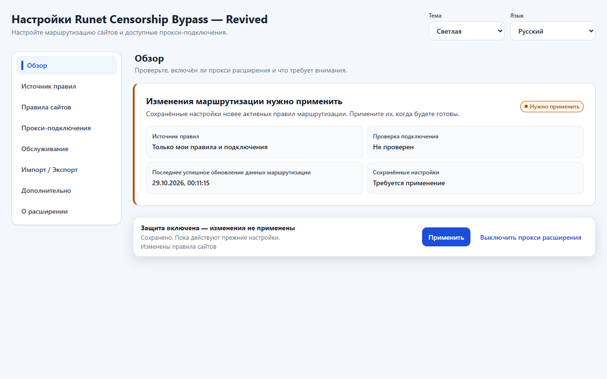
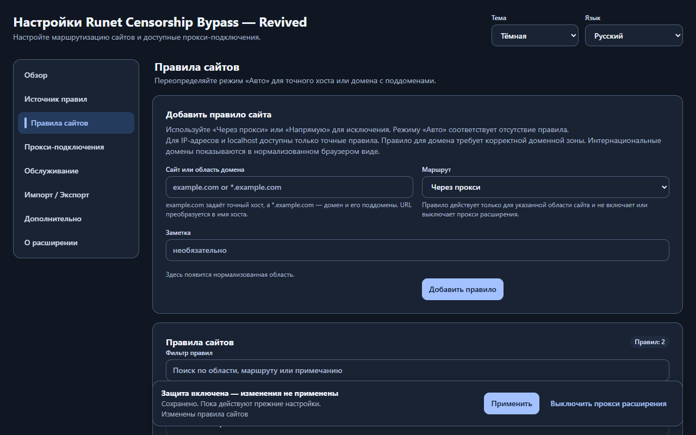

  

# Runet Censorship Bypass — Revived

Независимый форк [Anticensority](https://github.com/anticensority/runet-censorship-bypass).
**Chromium 1.0.1 — Revived** доступен для ручной установки. В магазинах пока
опубликована **1.0.0** под прежним названием; обновления готовятся отдельно.

Выбирайте, как браузер открывает сайты: по автоматическим правилам, через
настроенный прокси или напрямую. Расширение для Chromium и Firefox с интерфейсом
на русском и английском языках.

Расширение не предоставляет VPN или прокси-сервер. Оно использует выбранный
источник маршрутов, ваши прокси и отдельно запущенные Tor, Tor Browser или WARP.

[Установка](docs/user/INSTALLATION.md) ·
[Руководство 1.0](docs/user/USER_GUIDE_1_0.md) ·
[Помощь и сообщения об ошибках](SUPPORT.md) ·
[English](#english)

## Скачать

| Браузер | Версия | Установка из магазина |
| --- | --- | --- |
| **Chrome, Brave и совместимые Chromium-браузеры** | **1.0.0** | [Chrome Web Store](https://chromewebstore.google.com/detail/poohkdbmgajmcifcaijdjgiihghlgbph) |
| **Firefox 154+** | **1.0.0** | [Firefox Add-ons](https://addons.mozilla.org/ru/firefox/addon/runet-censorship-bypass-mv3/) |

Магазинные установки получают одобренные обновления через браузер.
Для ручной установки уже доступен **Chromium ZIP 1.0.1**. Подписанный Firefox
XPI пока остаётся **1.0.0**; Firefox 1.0.1 готовится к отправке в Mozilla.

Расчётная совместимость **1.0.1** — настольный **Chromium 108+**; для
подготовленного Firefox 1.0.1 — **Firefox 140+**, включая ESR, с необходимыми API.
Это оценка по используемым технологиям, а не проверка каждой версии и каждого
форка. [Требования и проверенные версии](docs/development/BROWSER_COMPATIBILITY.md).

**Ручная установка:** [Chromium ZIP 1.0.1](https://github.com/aVitomin/runet-censorship-bypass/releases/download/v1.0.1/runet-censorship-bypass-mv3-1.0.1-4b9a9b3.zip) ·
[подписанный Firefox XPI 1.0.0](https://github.com/aVitomin/runet-censorship-bypass/releases/download/v1.0.0/runet-censorship-bypass-firefox-1.0.0-signed.xpi) ·
[изменения и файлы v1.0.1](https://github.com/aVitomin/runet-censorship-bypass/releases/tag/v1.0.1).

### Быстрый старт

1. Установите расширение из магазина своего браузера и закрепите его значок.
2. В Firefox разрешите работу в приватных окнах: это нужно для общей настройки прокси.
3. Откройте настройки, выберите источник и нужные подключения.
4. Нажмите **Сохранить настройки**, затем **Применить**.

[Подробная установка, обновление и проверка файлов](docs/user/INSTALLATION.md).
Архивы **Source code** предназначены для разработки.

## Как пользоваться версией 1.0

Откройте сайт и нажмите значок расширения:

| Режим | Что делает |
| --- | --- |
| **Авто** | Следует выбранному источнику и общим правилам |
| **Прокси** | Использует подходящее настроенное подключение |
| **Напрямую** | Обходит прокси расширения для этого сайта |

Правило можно задать для одного хоста или домена с поддоменами. **Напрямую**
имеет приоритет над **Прокси**. В режиме **Только мои правила и подключения**
автоматическая база не нужна.

**Сохранить** записывает настройки, **Применить** включает сохранённые изменения.
До применения продолжают действовать прежние настройки. Обновление базы
не включает выключенную маршрутизацию и не применяет отложенные правки.

[Подключения, источники, перенос настроек и обновления](docs/user/USER_GUIDE_1_0.md)

## Интерфейс

В Chromium 1.0.1 доступны светлая, тёмная и системная темы.
Интерфейс работает на русском и английском.

Тёмная тема Chromium 1.0.1

Интерфейс магазинной версии 1.0.0

Chromium слева, Firefox справа.

  
  

Посмотреть настройки

[Все снимки интерфейса](docs/assets/releases/1.0/README.md)

## Помощь и приватность

Начните с [проверок и формы сообщения об ошибке](SUPPORT.md).
Состояние **Защита включена** означает управление маршрутизацией; оно не
гарантирует доступность сайтов, анонимность или шифрование. Используйте
доверенные источники и прокси.

[Приватность 1.0](docs/release/PRIVACY_1_0.md) ·
[Сообщить об уязвимости приватно](SECURITY.md) ·
[Вся документация](docs/README.md)

Проверить скачанные файлы

**Chromium 1.0.1** — `runet-censorship-bypass-mv3-1.0.1-4b9a9b3.zip`

SHA-256: `8bd77fab8e414d2bc092801153fcf731b43bf1581f3588a5ec6cffab9daffdd8`

[Контрольная сумма ZIP](https://github.com/aVitomin/runet-censorship-bypass/releases/download/v1.0.1/runet-censorship-bypass-mv3-1.0.1-4b9a9b3.zip.sha256.txt)

**Firefox 1.0.0** — `runet-censorship-bypass-firefox-1.0.0-signed.xpi`

SHA-256: `74ff7eca8eb8f50e5bca57b1642894db473e99f990e1dfbb936faf5d66162b6c`

[Контрольная сумма XPI](https://github.com/aVitomin/runet-censorship-bypass/releases/download/v1.0.0/runet-censorship-bypass-firefox-1.0.0-signed.sha256.txt) ·
[Выпуск Firefox 1.0.0](https://github.com/aVitomin/runet-censorship-bypass/releases/tag/v1.0.0)

## English

**Runet Censorship Bypass — Revived** is an independent Anticensority fork.
**Chromium 1.0.1** is available as a manual ZIP download with the new name and
light/dark/system themes. Store updates are being prepared separately; the
current store release and signed Firefox package remain **1.0.0**.

Choose **Auto**, **Proxy**, or **Direct** for websites in Chromium and Firefox.
The extension controls browser routing and provides no VPN or proxy service.
Save records settings; Apply activates them.

Install **1.0.0** from [Chrome Web Store](https://chromewebstore.google.com/detail/poohkdbmgajmcifcaijdjgiihghlgbph) or
[Firefox Add-ons](https://addons.mozilla.org/ru/firefox/addon/runet-censorship-bypass-mv3/). Firefox requires version **154+**.
Manual downloads are **Chromium 1.0.1** (expected Chromium 108+) and signed
**Firefox 1.0.0** (Firefox 154+). See [installation](docs/user/INSTALLATION.md#english-summary),
[the 1.0 guide](docs/user/USER_GUIDE_1_0.md#english-summary), and [help](SUPPORT.md#english).

Разработчикам и пользователям старых версий

[Разработка](docs/development/DEVELOPMENT.md) ·
[Архитектура](docs/development/ARCHITECTURE.md) ·
[Тестирование](docs/development/TESTING.md) ·
[Процесс выпуска](docs/development/RELEASE_PROCESS.md) ·
[Участие в проекте](CONTRIBUTING.md)

Firefox 0.0.4.0: [руководство](docs/user/USER_GUIDE.md),
[решение проблем](docs/user/TROUBLESHOOTING.md),
[приватность](docs/user/PRIVACY_AND_SECURITY.md).
[Исторический README](docs/legacy/UPSTREAM_README.md).

Проект основан на [Anticensority](https://github.com/anticensority/runet-censorship-bypass)
с сохранением авторства и истории. Лицензия: [GNU GPL v3](LICENSE).
