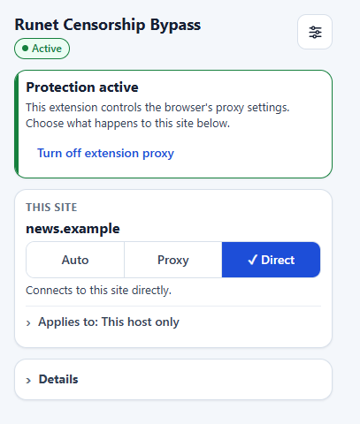
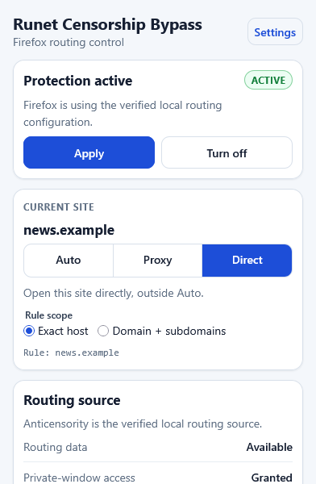
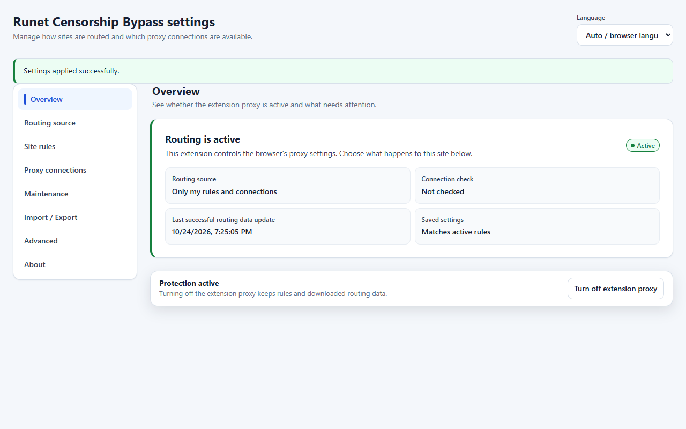
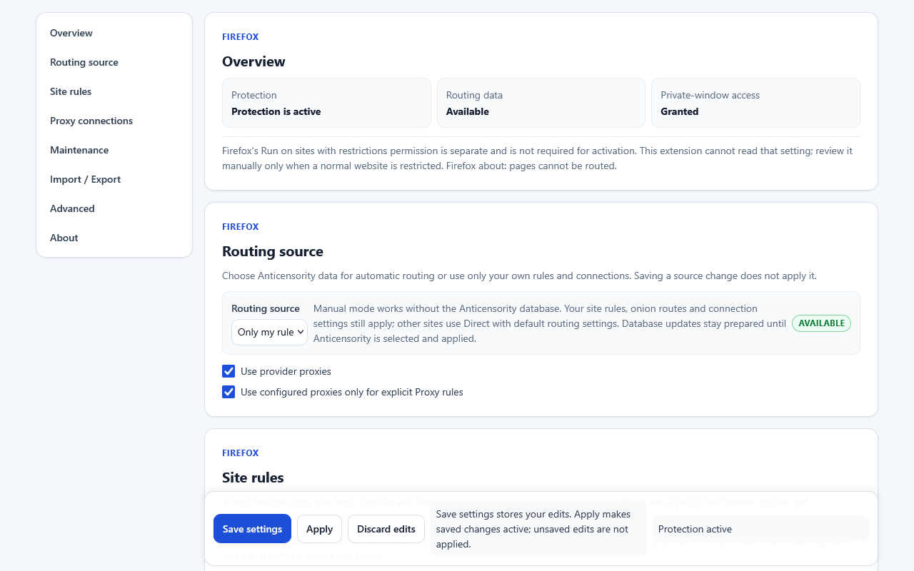

  

# Runet Censorship Bypass

Выбирайте, как браузер открывает сайты: по автоматическим правилам, через
настроенный прокси или напрямую. Расширение для Chromium и Firefox с интерфейсом
на русском и английском языках.

Расширение не предоставляет VPN или прокси-сервер. Оно использует выбранный
источник маршрутов, ваши прокси и отдельно запущенные Tor, Tor Browser или WARP.

[Установка](docs/user/INSTALLATION.md) ·
[Руководство 1.0](docs/user/USER_GUIDE_1_0.md) ·
[Помощь и сообщения об ошибках](SUPPORT.md) ·
[English](#english)

## Скачать

| Браузер | Доступная версия | Установка |
| --- | --- | --- |
| **Chromium** — Chrome, Brave и совместимые браузеры | [1.0.0](https://github.com/aVitomin/runet-censorship-bypass/releases/tag/v1.0.0) | [Скачать ZIP](https://github.com/aVitomin/runet-censorship-bypass/releases/download/v1.0.0/runet-censorship-bypass-mv3-1.0.0-9de66de.zip) и загрузить распакованным |
| **Firefox 154+** | [0.0.4.0, подписанная Mozilla](https://github.com/aVitomin/runet-censorship-bypass/releases/tag/v0.0.4.0) | [Скачать XPI](https://github.com/aVitomin/runet-censorship-bypass/releases/download/v0.0.4.0/runet-censorship-bypass-firefox-0.0.4.0-signed.xpi) и открыть в Firefox |

**Версии 1.0 для Chrome Web Store и Firefox Add-ons отправлены на проверку.**
Публичных ссылок на установку из магазинов пока нет. Подписанный Firefox 1.0
пока недоступен; возможности старой версии описаны в [руководстве 0.0.4.0](docs/user/USER_GUIDE.md).

### Chromium: быстрый старт

1. Распакуйте ZIP в постоянную папку.
2. Откройте `chrome://extensions` или `brave://extensions`, включите **Режим разработчика**.
3. Нажмите **Загрузить распакованное расширение** и выберите папку с `manifest.json`.
4. В настройках расширения выберите источник и нужные подключения.
5. Нажмите **Сохранить настройки**, затем **Применить**.

Не удаляйте папку после установки. Архивы **Source code** не являются готовым
расширением. [Подробная установка, обновление и проверка файлов](docs/user/INSTALLATION.md).

## Как пользоваться версией 1.0

Откройте сайт и нажмите значок расширения:

| Режим | Что делает |
| --- | --- |
| **Авто** | Следует выбранному источнику и общим правилам |
| **Прокси** | Использует подходящее настроенное подключение |
| **Напрямую** | Обходит прокси расширения для этого сайта |

Правило можно задать для одного хоста или домена с поддоменами. **Напрямую**
имеет приоритет над **Прокси**. В режиме **Только мои правила и подключения**
автоматическая база не нужна.

**Сохранить** записывает настройки, **Применить** включает сохранённые изменения.
До применения продолжают действовать прежние настройки. Обновление базы
не включает выключенную маршрутизацию и не применяет отложенные правки.

[Подключения, источники, перенос настроек и обновления](docs/user/USER_GUIDE_1_0.md)

## Интерфейс

Chromium 1.0 слева, Firefox 1.0 справа. Firefox на снимках — версия, ожидающая
проверки Mozilla; доступный подписанный Firefox 0.0.4.0 выглядит иначе.

  
  

Посмотреть настройки

[Все снимки интерфейса](docs/assets/releases/1.0/README.md)

## Помощь и приватность

Начните с [проверок и формы сообщения об ошибке](SUPPORT.md).
Состояние **Защита включена** означает управление маршрутизацией; оно не
гарантирует доступность сайтов, анонимность или шифрование. Используйте
доверенные источники и прокси.

[Приватность 1.0](docs/release/PRIVACY_1_0.md) ·
[Сообщить об уязвимости приватно](SECURITY.md) ·
[Вся документация](docs/README.md)

Проверить скачанные файлы

**Chromium 1.0.0** — `runet-censorship-bypass-mv3-1.0.0-9de66de.zip`

SHA-256: `0faa3e0208c9d8295d2216066184930ece89eddeae20d1d37e9ede0c2a1a48bb`

[Контрольная сумма ZIP](https://github.com/aVitomin/runet-censorship-bypass/releases/download/v1.0.0/runet-censorship-bypass-mv3-1.0.0-9de66de.zip.sha256.txt)

**Firefox 0.0.4.0** — `runet-censorship-bypass-firefox-0.0.4.0-signed.xpi`

SHA-256: `c7e3042e48819644673db92b9150a9d54a551281046212d896a7f7202bc9c34c`

[Контрольная сумма XPI](https://github.com/aVitomin/runet-censorship-bypass/releases/download/v0.0.4.0/runet-censorship-bypass-firefox-0.0.4.0-signed.sha256.txt)

## English

Choose **Auto**, **Proxy**, or **Direct** for websites in Chromium and Firefox.
The extension controls browser routing and provides no VPN or proxy service.
Save records settings; Apply activates them.

Chromium **1.0.0** is available as an unpacked ZIP. Store submissions for Chrome
and Firefox **1.0** are awaiting review. The signed Firefox download is still
**0.0.4.0**. See [installation](docs/user/INSTALLATION.md#english-summary),
[the 1.0 guide](docs/user/USER_GUIDE_1_0.md#english-summary), and [help](SUPPORT.md#english).

Разработчикам и пользователям старых версий

[Разработка](docs/development/DEVELOPMENT.md) ·
[Архитектура](docs/development/ARCHITECTURE.md) ·
[Тестирование](docs/development/TESTING.md) ·
[Процесс выпуска](docs/development/RELEASE_PROCESS.md) ·
[Участие в проекте](CONTRIBUTING.md)

Firefox 0.0.4.0: [руководство](docs/user/USER_GUIDE.md),
[решение проблем](docs/user/TROUBLESHOOTING.md),
[приватность](docs/user/PRIVACY_AND_SECURITY.md).
[Исторический README](docs/legacy/UPSTREAM_README.md).

Проект основан на [Anticensority](https://github.com/anticensority/runet-censorship-bypass)
с сохранением авторства и истории. Лицензия: [GNU GPL v3](LICENSE).
